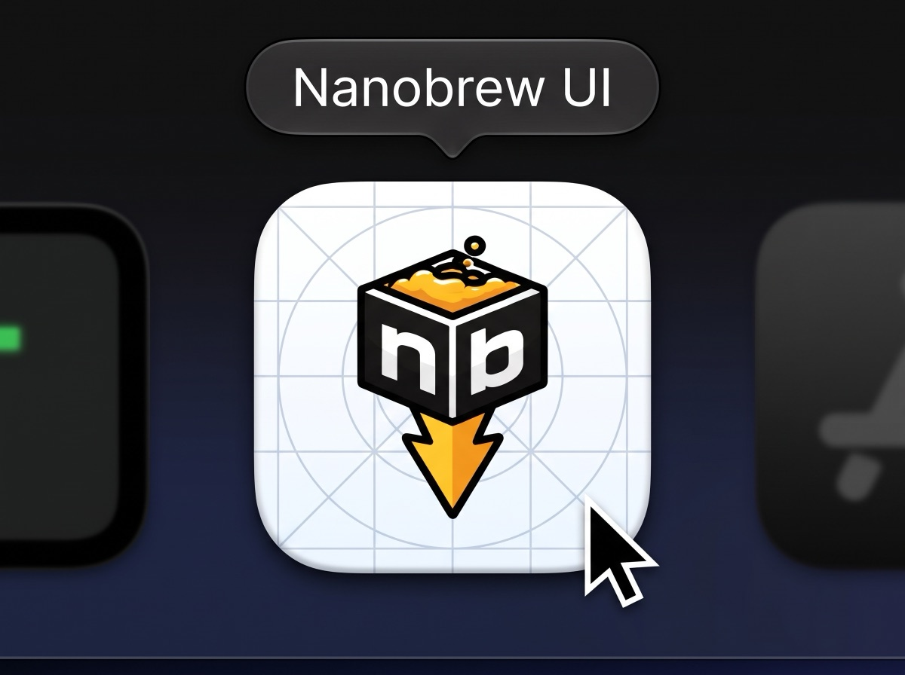

<p align="center">
  
</p>

# Nanobrew UI

A native macOS app for [nanobrew](https://github.com/justrach/nanobrew) (`nb`). It shows what nb has installed,
what is out of date and which services run, and it runs every nb command from a window, with the live output in a
console. nb does all the work; the app only shows what nb has and prints.

**Unofficial. Not made by the nanobrew maintainer.** Please report problems with the app here, not to nanobrew.

## What it does

- **Installed, Updates, Discover, Services, Maintenance, Bundle, Settings**: every nb command for macOS
  (all but `--deb` and `help`), with a confirmation before anything that removes or resets, and a typed "yes"
  before `nb nuke`.
- **A status line** shows what the last command did and how long it took. The console opens by itself while a
  command runs; ⌘J opens and closes it, and you can pin it open.
- **One command at a time.** Changing commands wait in a queue, because nb locks while it works. If you quit
  while one runs, nb finishes it in the background.
- **Light and dark**, following your Mac's setting. Amber marks only what needs your attention.
- **Casks nb can't upgrade in place.** nb upgrades zip and tar casks in place. For a cask it skips (a disk image,
  for example), the row shows "Can't upgrade in place" and a **Reinstall…** button. Reinstall removes the app
  first and installs the new version only when the remove succeeded; if that install then fails (for example
  with no network), the app stays removed until you install it again from Discover. The app warns you before
  it starts, and Reinstall is never part of "Upgrade All Casks".

## Install

```sh
nb install --cask Rex57/tap/nanobrew-ui
```

Upgrade it with `nb upgrade --cask Rex57/tap/nanobrew-ui` (or Updates > Upgrade in the app). nb records a tap
cask under its full name, so use the full name; `nb upgrade --cask nanobrew-ui` answers "not installed". After an
upgrade of itself, the app offers a restart.

The app is signed ad hoc, not with an Apple Developer ID, and it is not notarized. nb does not quarantine what it
installs, so the app opens when nb installs it. A copy from `brew install --cask` or from a browser download gets
the quarantine flag, and Gatekeeper blocks it. macOS can ask again for the App Management permission after an
update.

Requirements: macOS 14 (Sonoma) or later, and nanobrew. Tested with nb 0.1.214.

## Build

```sh
swift build                 # debug build
swift test                  # tests (NanobrewKit, with a fake nb and fixture state files)
scripts/bundle.sh           # dist/Nanobrew UI.app, dist/Nanobrew-UI-<version>.zip, its sha256, dist/nanobrew-ui.rb
```

A Swift package, no Xcode project and no third-party dependency: the library `NanobrewKit` holds all logic, and
the `NanobrewUI` target holds the SwiftUI views. `scripts/make-icon.swift` makes the icon from nanobrew's logo.

To try the app without touching your real nanobrew, run it against the test fake: see
[Manual checks with launch arguments](docs/TESTING.md#manual-checks-with-launch-arguments).

## Docs

- [Architecture](docs/ARCHITECTURE.md): how the app is built and how it runs nb.
- [Design language](docs/DESIGN.md): the look, the colours and what they mean, the components.
- [Decisions](docs/DECISIONS.md): the main choices and their reasons.
- [Testing](docs/TESTING.md): the tests, the fake nb, and how to check the app safely.
- [Releasing](docs/RELEASING.md): the zip, the cask and the release checks.
- [UI prototype](docs/UI/prototype_UI.html): the approved mockups, in light and dark (open the file in a browser).

## Future ideas

What comes next, and what is open, is in the [roadmap](ROADMAP.md).

## License

Apache-2.0 (see LICENSE). No code is copied from Homebrew's BrewUI.

The nanobrew logo (`Sources/NanobrewKit/Resources/nanobrew-logo.png`, used in the app icon and the sidebar) is Copyright 2026 Rach Pradhan, licensed
under Apache-2.0, from the nanobrew repository.

The icons are from [Lucide](https://lucide.dev) (lucide-static 1.66.0, `Sources/NanobrewKit/Resources/Icons`, drawn
at stroke width 1.5), licensed under the ISC License, Copyright (c) Lucide Contributors.
