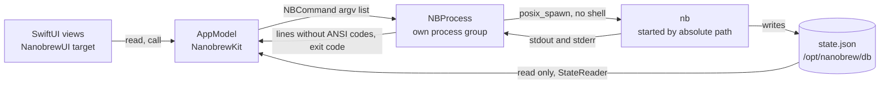

# Architecture

> Status: current · Owner: Rex57 · Reviewed: 2026-11-01

Nanobrew UI is a thin layer over nanobrew (`nb`). nb does all the work. The app reads what nb has installed, runs
nb commands, and shows what nb prints.

## The two targets

`Package.swift` defines one Swift package (tools version 6.0, so Swift 6 language mode) for macOS 14 or later.
It has no third-party dependency and no Xcode project.

| Target | Kind | Holds |
|---|---|---|
| `NanobrewKit` | library | All logic: the state reader, the nb locator, the command catalogue, the process runner, the parsers, the status texts, the Reinstall rules and the `AppModel`. Also the resources: the Lucide icons and the nanobrew logo. |
| `NanobrewUI` | executable | The SwiftUI views and the window code. No rule lives here. |
| `NanobrewKitTests` | tests | Swift Testing suites. They link `NanobrewKit` only. |

Why two targets: the tests link the library, not the app target. So every rule that a test must check lives in
`NanobrewKit`. The views only read the model and call it.

### Files

| File | Main types |
|---|---|
| `Sources/NanobrewKit/AppModel.swift` | `AppModel`: the app's state, the queue, the refresh, the status line |
| `Sources/NanobrewKit/Runner.swift` | `NBProcess`: one nb run; `stripANSI` |
| `Sources/NanobrewKit/Command.swift` | `NBCommand`: the command catalogue |
| `Sources/NanobrewKit/State.swift` | `StateSnapshot`, `StateReader`, `NBLocator`, `launchArgument` |
| `Sources/NanobrewKit/Parsers.swift` | `PackageInfo`, `Trust`, `SearchResult`, `OutdatedPackage`, `Service`, `AutoupdateStatus`, `parseTelemetry`, `parseNBVersion`, `testedNBVersion` |
| `Sources/NanobrewKit/Status.swift` | `CommandStatus`, `formatDuration` |
| `Sources/NanobrewKit/Reinstall.swift` | `UnsupportedSkip`, `UpgradeOutcome`; the verdicts, `readyUpdates`, `upgradeReady`, `upgradeAllCasks` and `reinstall` on `AppModel` |
| `Sources/NanobrewKit/Icons.swift` | `Icon`, `nanobrewLogo` |
| `Sources/NanobrewUI/NanobrewUIApp.swift` | `NanobrewUIApp`, `AppDelegate`, `ContentView`, `NotInstalledView`, `NotSetUpView`, `relaunch` |
| `Sources/NanobrewUI/WindowSupport.swift` | `WindowReader`, `CloseGuard` |
| `Sources/NanobrewUI/Theme.swift` | `Theme` (the colour tokens), `IconView`, `Sidebar`, the button styles, `Pill`, `ScreenTitle`, `SettingsRow`, `ArrowSelection`, `ResizeEdge` |
| `Sources/NanobrewUI/ConsoleView.swift` | `ConsoleView`, `ConsoleText`, `StatusLine` |
| `Sources/NanobrewUI/InstalledView.swift` | `InstalledView`, `PackageDetailView` |
| `Sources/NanobrewUI/UpdatesView.swift` | `UpdatesView`, `ReinstallDialog` |
| `Sources/NanobrewUI/DiscoverView.swift` | `DiscoverView` |
| `Sources/NanobrewUI/ServicesView.swift` | `ServicesView`, `StatusPill` |
| `Sources/NanobrewUI/MaintenanceView.swift` | `MaintenanceView` |
| `Sources/NanobrewUI/SettingsView.swift` | `BundleView`, `SettingsView` |
| `Sources/NanobrewUI/AboutView.swift` | `AboutView`, `AboutMenuItem` |

## The big picture



## Data flow

The app has two sources of data. It never asks a Homebrew API.

### state.json, read only

`StateReader.read(path:)` reads nanobrew's `state.json` into a `StateSnapshot`: the formulae (name, version,
pinned, install time), the casks (token, version, apps, binaries) and the history (earlier versions per formula;
`earlierVersions(of:)` gives the entries without the installed version, newest first, with their install times).

- The path is `/opt/nanobrew/db/state.json`, or the `-NBStatePath` launch argument.
- The JSON key `kegs` holds the formulae. Unknown fields are ignored.
- The folder is missing: the result is nil, and the app shows "nanobrew is not set up".
- The folder exists but the file does not: the result is an empty snapshot. `nb init` makes the folder, and nb
  writes the file later.
- The file does not decode: the app shows a red line "Cannot read …" and keeps the last good snapshot.

### nb's text output

All other data comes from the text that nb prints. nb prints ANSI colour codes even into a pipe. `NBProcess`
removes them (`stripANSI`: CSI, OSC and two-byte escape sequences) and removes carriage returns. It does this
before any parser or view sees a line.

Parsers exist only where the UI needs structure. Each one follows the nb source code that prints the text.

| Parser | nb command |
|---|---|
| `PackageInfo` | `nb info <name>`, `nb info --cask <token>` |
| `Trust` | the trust line of `nb info`, in plain words ("Source verified · not probed yet") |
| `SearchResult` | `nb search <query>` |
| `OutdatedPackage` | `nb outdated`, `nb outdated --cask` |
| `Service` | `nb services list` |
| `AutoupdateStatus` | `nb autoupdate status` |
| `parseTelemetry` | `nb telemetry status` |
| `parseNBVersion` | `nb version` |
| `UnsupportedSkip` | the skip line of `nb upgrade` (see [The Reinstall fallback](#the-reinstall-fallback)) |

Every other output goes to the console as plain text: doctor, cleanup, where, leaves, completions, bundle dump,
trust attest, migrate and update. The detail pane shows `nb deps --tree` as text, without its `==>` line.

When nanobrew adds `--json` output, these parsers can go.

### Where the app writes

The app never writes `state.json` or any file under `/opt/nanobrew`. Only nb changes the system. The app writes
only these:

- Its own preferences (domain `io.github.rex57.nanobrew-ui`): the Settings nb path (`SavedNBPath`) and the
  Reinstall verdicts (`ReinstallVerdict.<token>`).
- The file that the user picks in Bundle > Export: nb's stdout of `nb bundle dump`. Nothing is written when nb
  fails.
- The clipboard, on Copy in Settings > Shell completions.

## The process model

`NBProcess` (`Sources/NanobrewKit/Runner.swift`) is one nb run.

- **Start.** `posix_spawn` starts nb at its absolute path, with the argv list `[path] + args`. No shell is
  involved, so an argument with spaces, quotes or a semicolon stays one argument. The path is absolute because
  a GUI app gets a short `PATH`.
- **Input.** stdin is `/dev/null`, so nb never waits for input.
- **Output.** stdout and stderr go to one pipe, so the console shows both in their order. With
  `separateStderr`, stderr gets its own pipe; the app uses this when it parses stdout.
- **Process group.** `POSIX_SPAWN_SETPGROUP` with group 0 makes nb the leader of its own process group.
  `POSIX_SPAWN_CLOEXEC_DEFAULT` keeps the app's other file descriptors out of nb.
- **Environment.** nb gets the app's environment unchanged.
- **Lines.** A reader thread splits the output at each newline and hands on the lines in batches. The stream
  ends after nb exits. `exitCode` is nil when a signal ended nb, and nil until the process was reaped (a reader
  whose task was cancelled stops early and gets no code). A cancelled outdated check or detail fetch changes
  nothing: the previous list, count, error and detail stay.
- **Cancel.** `cancel()` sends `SIGTERM` to the whole process group (`kill(-pid, SIGTERM)`), so nb's children
  stop too. When nb was not reaped 5 s later, it sends `SIGKILL` to the group (D4). The reader waits for the exit
  with `WNOWAIT` and reaps under a lock that the `SIGKILL` check also takes, so a run that ended is never
  signalled again (its pid may be reused).

### Three ways to run a command

| Method of `AppModel` | Console | Use |
|---|---|---|
| `run(_:)` | yes | Every command that the user starts. Changing commands go through the serial queue. |
| `capture(_:)` | no | Read-only data: `info`, `deps --tree`, `version`, `telemetry status`, `autoupdate status`. Returns the lines and the exit code. |
| `captureStdout(_:)` (private) | no | Read-only data that is parsed: `search`, `outdated`, `services list`, `completions`, `bundle dump`. A non-zero exit throws nb's error text. |

### The queue

- A command with `changes == true` waits its turn. `run(_:)` chains its task onto the task of the last changing
  command. `waiting` lists the queued commands, and `running` holds the one that runs.
- A read-only command starts at once, in parallel with anything else.
- `inProgress` lists every command that runs now, read-only ones too.
- Cancel stops every process that runs now. The commands that wait in the queue then run.

nb has its own lock as well. nb takes an exclusive lock on `/opt/nanobrew/db/state.json.operation.lock` for every
command except `help`, `version`, `completions` and `autoupdate` (`acquireCommandLock` in nanobrew's
`src/main.zig`). So two nb runs never work on the state at the same time. The app's queue keeps its own changing
commands in order, so they do not compete for that lock.

### The console

Each run adds a line `$ <command>`, then nb's output lines, then one end line: `Done: <command>`,
`Failed: <command> (exit code <n>)` or `Cancelled: <command>`. The console keeps the last 20,000 lines
(`consoleLimit`, D3); older lines drop off the top, and `consoleDropped` counts them. `ConsoleText` appends only the
new lines and removes the dropped ones from the top of its text, so it shows the same lines; after a hide and show
it starts again from the kept lines.

## The command catalogue

`NBCommand` (`Sources/NanobrewKit/Command.swift`) lists every nb command that the app runs. Each command has:

- `args`: the exact argv after the nb path.
- `changes`: true when the command changes the system. It then waits in the queue.
- `confirmation`: `.none`, `.ask` (a "Run …?" question) or `.typeYes` (the user must type `yes`).
- `program`: nil for nb. Only `nb init` sets it (to `/usr/bin/osascript`).
- `title`: the command as a person would type it, for example `nb remove jq`.
- `verb` and `names`: nb's subcommand (`install`) and the packages it acts on (`jq`, not `jq@trusted`). The
  catalogue sets them; the status line, the restart offer and Discover read them instead of the argv. Two commands
  are equal when their program and argv are equal.

### Read-only commands

| Command | argv |
|---|---|
| `doctor` | `doctor` |
| `info`, `caskInfo` | `info <name>`, `info --cask <token>` |
| `depsTree` | `deps --tree <name>` |
| `search` | `search <query>` |
| `outdated`, `outdatedCasks` | `outdated`, `outdated --cask` |
| `servicesList` | `services list` |
| `cleanupDryRun` | `cleanup --dry-run [--prune-kegs]` |
| `autoupdateStatus` | `autoupdate status` |
| `where` | `where <pattern>` |
| `leaves` | `leaves [--tree]` |
| `bundleDump` | `bundle dump` |
| `telemetryStatus` | `telemetry status` |
| `completions` | `completions <shell>` |
| `version` | `version` |

### Changing commands

| Command | argv | Confirmation |
|---|---|---|
| `install` | `install [--cask] [--shims] [--trusted-only] <name>[@trusted]` (the name may be `user/tap/name`) | none |
| `upgrade`, `upgradeCask`, `upgradeAll` | `upgrade <name>`, `upgrade --cask <token>`, `upgrade` | none |
| `pin`, `unpin` | `pin <name>`, `unpin <name>` | none |
| `link`, `unlink` | `link <name>`, `unlink <name>` | none |
| `switchVersion` | `switch <name>@<version>` | none |
| `services` | `services start\|stop\|restart <name>` | none |
| `doctorProbe` | `doctor --probe [<package>]` (probes write their results to state.json) | none |
| `update`, `updateRegistry` | `update`, `update-registry` | none |
| `autoupdate` | `autoupdate enable\|disable\|run [--upgrade]` | none |
| `telemetry` | `telemetry on\|off` | none |
| `trustAttest` | `trust attest <package> [--cask] [--output <file>]` | none |
| `initNanobrew` | `/usr/bin/osascript -e <script> <nb path>` (see [Admin rights](#admin-rights)) | none |
| `remove`, `removeCask` | `remove <name>`, `remove --cask <token>` | ask |
| `rollback` | `rollback <name>` | ask |
| `cleanup` | `cleanup [--prune-kegs]` | ask |
| `bundleInstall` | `bundle install <file>` | ask |
| `migrate` | `migrate` | ask |
| `nuke` | `nuke --yes` | typed "yes" |

`nuke` always carries `--yes`, because without it nb waits for "yes" on stdin. The app asks for the typed "yes"
itself. Updates also builds commands from the outdated list: `upgradeReady` gives one `upgrade <names…>` for the
ready formulae and one `upgrade --cask <tokens…>` for the ready casks.

## The model

`AppModel` (`Sources/NanobrewKit/AppModel.swift`) is a `@MainActor @Observable` class. The views read it and call
it. `AppModel.fromLaunch()` makes the app's model from the launch arguments.

| State | Meaning |
|---|---|
| `snapshot`, `notSetUp`, `stateError` | The last good `state.json`, whether nanobrew is set up, and the read error |
| `nbPath`, `notInstalled` | The nb that the locator found, or none |
| `console`, `consoleShown`, `consolePinned` | The console lines and whether the console shows |
| `running`, `waiting`, `inProgress` | The queue |
| `commandsEnded` | Goes up by one each time a command ends |
| `pendingConfirmation` | A command that waits for the user's yes |
| `status` | The status line: a `CommandStatus` |
| `outdatedPackages`, `outdatedError`, `outdatedChecked`, `updatesCount` | The last outdated check |
| `restartOffered` | True after an upgrade replaced the app itself |
| `canCleanUp(pruneKegs:)` | D8: true only after a successful `dryRunCleanup` with the same `--prune-kegs` setting; `cleanUp` uses it up |
| `reinstalling` | The casks whose Reinstall has not ended |

### Requests and confirmations

The views call `request(_:)`. A command with a confirmation waits in `pendingConfirmation`, and the window shows
the question. `confirm(typed:)` runs it; a `.typeYes` command runs only when the typed text is exactly `yes`.
`decline()` drops it.

### The status line

`CommandStatus` has a kind (`running`, `success`, `failure`, `cancelled`, `skipped`), a text and a time.

- While a command runs: `Running: nb install jq`.
- A success names what happened and how long it took: `Installed jq in 0.84 s`. Commands without their own verb
  say `nb doctor finished in <duration>`.
- A failure: `Failed: nb upgrade node (exit code 1)`. A cancel: `Cancelled: nb link a`.
- A launch check or ⌘R: `Checked <n> packages in <duration>`.
- A read-only command that runs while a change runs does not replace the change's status.

Durations come from a monotonic clock (`ContinuousClock`), which tests can replace. `formatDuration` writes under
0.1 s in ms (`84 ms`), under 10 s with two decimals (`0.84 s`), under 1 minute with one decimal (`12.3 s`), and
then minutes and seconds (`1 m 05 s`). It picks the unit after it rounds.

### The console state

The console is closed at launch. It opens when a command starts. It closes when the last command ends, unless
the user pinned it ("Keep open"). ⌘J opens and closes it.

### Refresh

There is no file watcher. The app reads again at these moments:

| When | What runs |
|---|---|
| Launch, and the app becomes active | `becameActive()` (the window's first task and the app delegate): `checkAgain()` (find nb, read `state.json`), then `checkOutdated()`, not awaited, unless one of these background checks still runs. So launch starts one check; the session's first check reports in the status line |
| ⌘R, the top-bar button, Updates > Check Again | `refresh()`: `checkAgain()`, then `checkOutdated(report: true)` |
| After every command | `checkAgain()` in the run, then `commandsEnded` goes up by one |
| After a changing command | `checkOutdated()`, started by the run. A newer check replaces the one before: the older one's result is dropped, while its nb runs end by themselves. A read-only command (Doctor, Where, Leaves, a dry run) starts no check |
| Updates opens | `checkOutdated()` |

The views with their own fetched data key a `.task(id:)` on `commandsEnded`, so they load again after each
command: the detail pane (`nb info`), Discover's results, the services list, the auto-update status and the
telemetry status.

### The outdated list

`outdated()` runs `nb outdated` and `nb outdated --cask` in parallel. It takes the formulae from the first and the
casks from the second. One list feeds three places: the count on Updates in the sidebar, the Updates table and the
marks in Installed. `updatesCount` is nil when nothing is outdated or the check failed, so the sidebar shows no
count. `report: true` puts the check in the status line. A check after a command does not report, so it does not
replace the command's result.

### Self-upgrade

`UpgradeOutcome` (`Reinstall.swift`) decides it from the command, its output, its exit code and `state.json` read
after the run; `execute` only asks it. After an upgrade exits 0, the outcome looks at `state.json`. The upgrade must name `nanobrew-ui` (or a tap path
that ends in `/nanobrew-ui`), or name nothing. If `state.json` then holds another version of `nanobrew-ui` than the
running app, `restartOffered` turns true. The window shows "Restart to use the new version" and a Restart button.
`relaunch` calls `AppModel.restart(mayQuit:open:quit:)` (D7): it asks the quit question first (only while a
changing command runs or waits), opens the app bundle again as a new copy (`open -n`) only after a yes, and then
quits this one without a second question. When `open` fails, the status line says "Restart failed: …" and this
copy keeps running.

### Quit rules

`askBeforeQuit` is true while a changing command runs or waits, or a Reinstall has not ended. Read-only commands
do not count. A quit then asks first:

- Title: "A command is still running", or "A reinstall is not finished".
- Buttons: Keep Running (the default) and Quit.
- Message (`quitMessage`): "nb keeps running in the background until it ends. You will not see its output." While
  a Reinstall removes a cask, or has removed it and its install has not started, the message names the cask. It
  says the cask stays removed until the user installs it again from Discover.

## Locating nb

`NBLocator.locate` returns the first candidate that is an executable file (not a folder):

1. The `-NBPath` launch argument. When it is given, it is the only candidate.
2. The path saved in Settings (`SavedNBPath`).
3. `/opt/nanobrew/prefix/bin/nb`.
4. `~/.local/bin/nb`.

No candidate: the app shows "nanobrew is not installed" with the install command as selectable text.

`-NBPath` is exclusive on purpose. A wrong or missing test path shows "nanobrew is not installed". It never falls back to
the Settings path or to the real nb, so a test can never reach a real nanobrew. Without `-NBPath`, the user's own
path wins over the default places.

`checkAgain()` runs the locator again (app active, ⌘R, after each command). Settings > nb path > Save calls
`saveNBPath(_:)`: it saves the path (an empty field clears it) and runs the locator again.

## The Reinstall fallback

nb upgrades a cask in place (a staged upgrade) only when its download is a zip, a tar.gz, a tar.xz or a bare
binary, and its artifacts are apps or binaries (`unsupportedReason` in nanobrew's `src/cask/upgrade.zig`). For any
other cask, `nb upgrade` skips it and prints:

```
    <token> (<old> -> <new>) [unsupported, skipping: <reason>]
```

The app does not guess which casks nb will skip. It uses nb's own verdict:

1. **Record.** `execute` gives each ended command's output to `UpgradeOutcome`; for an `upgrade`,
   `UnsupportedSkip.parse` finds the skip lines. `record` saves the installed (old) version and nb's reason in
   the app's preferences under `ReinstallVerdict.<token>`.
2. **Read.** `verdict(for:)` returns the reason only for a cask whose saved installed version equals the
   installed version in the outdated list. The verdict ends when the installed version changes (an upgrade or a
   reinstall). A read never deletes; the next skip of the same token overwrites it.
3. **Key.** The key is the token plus the installed version, not the new version. nb's trust check can fall back
   to an older verified build, so the new version in the skip line can differ from the one in `nb outdated
   --cask`. The installed version is the same in both.
4. **Plain words.** `UnsupportedSkip.plain` turns three of nb's reasons into short words for the badge: "disk
   image", "external installer" and "installer receipts". For any other reason the badge says only "Can't upgrade
   in place", and the tooltip shows nb's text.
5. **Upgrade buttons.** `readyUpdates` leaves out pinned rows and rows with a verdict. "Upgrade <n>" and "Upgrade
   All Casks" name only the ready rows, so a cask with a verdict is never part of them. The detail pane in
   Installed shows "Upgrade to <version>" by the same rule. "Upgrade All" runs plain
   `nb upgrade`, and nb skips what it cannot upgrade.
6. **Reinstall.** `reinstall(_:)` runs `nb remove --cask <token>`. Only when that exits 0 does it run
   `nb install --cask <token>`. When the install fails, the console and the status line say:
   "<token> was removed, but the new version did not install. Install it again from Discover." The remove asks
   no second question: the Reinstall dialog is the confirmation.

Each run clears the earlier success of the same command first. So a run that cannot start never counts as a
successful remove.

An upgrade with skips says so in the status line: `Upgraded puremac in <duration>; skipped firefox (can't upgrade
in place)`. When every named cask was skipped: `Nothing upgraded; skipped firefox (can't upgrade in place)`, with a
grey dot.

## Admin rights

Only `nb init` needs root. Every other command runs as the user. The "nanobrew is not set up" screen has a "Set
up nanobrew" button. It is disabled while a changing command runs or waits.

`NBCommand.initNanobrew(nbPath:)` runs `/usr/bin/osascript` with the argv `-e <script> <nb path>`. The script is:

```applescript
on run argv
    try
        do shell script (quoted form of (item 1 of argv)) & " init" with administrator privileges
    on error number -128
        return "Set-up cancelled"
    end try
end run
```

- The nb path enters as an argument and is quoted with `quoted form of`. It is never pasted into the script text.
- macOS shows its admin password dialog.
- "Don't Allow" raises error -128. The script then prints "Set-up cancelled" and exits 0, so it is not a failure.
- The console title is `sudo <nb path> init`, so the user sees which file runs as root.

## Window, close and quit

- The app has one main window, a SwiftUI `Window` scene, so there is no File > New Window. Its default size is
  1280 × 800, with a hidden title bar. About opens a second, small window.
- Closing the main window quits the app, as in a single-window utility. `WindowReader` hands the `NSWindow` to
  `AppDelegate.guardClose(of:)`. `CloseGuard` sits in front of SwiftUI's window delegate and forwards everything
  else to it. Its `windowShouldClose` calls `NSApp.terminate(nil)` and returns false.
- The quit then asks first while a changing command runs or waits (`applicationShouldTerminate` calls
  `mayQuit()`).
- On a quit, the app does not stop nb. nb runs in its own process group, and the app sends it no signal. nb ends
  its operation in the background, and nobody sees its output. Reason: a finished nb operation, or one that nb
  rolled back itself, is safer than one cut off halfway.

## The bundle script and the release zip

`scripts/bundle.sh` makes the release. `VERSION` at its top is the only place that sets the version.

1. `swift build -c release`.
2. Make `dist/Nanobrew UI.app`: the binary goes to `Contents/MacOS/NanobrewUI`. `NanobrewUI_NanobrewKit.bundle`
   (the icons and the logo) goes to `Contents/Resources`, where `codesign` seals it. `Icons.swift` looks there
   first, and falls back to `Bundle.module` for `swift run` and the tests.
3. Make the icon: `scripts/make-icon.swift` draws nanobrew's logo on a white 824-point rounded square (corner
   radius 185) on a 1024-pixel canvas. `sips` makes every size from 16 to 512 at @1x and @2x, and `iconutil` makes
   `AppIcon.icns`.
4. Write `Info.plist`: name "Nanobrew UI", bundle id `io.github.rex57.nanobrew-ui`, the version, minimum macOS 14.0.
5. `xattr -cr`: extended attributes would become `._` files in the zip and break the signature (nanobrew #425).
6. Sign ad hoc (`codesign --force --sign -`), then check with `codesign --verify --deep --strict`.
7. Zip with `ditto -c -k --norsrc --keepParent` to `dist/Nanobrew-UI-<version>.zip`. `--norsrc` keeps out the
   AppleDouble `._` entries; `--keepParent` puts `Nanobrew UI.app/` at the top of the zip.
8. Print the zip's sha256 (`shasum -a 256`) and write `dist/nanobrew-ui.rb`, the cask text:

```ruby
cask "nanobrew-ui" do
  version "<version>"
  sha256 "<sha256 of the zip>"

  url "https://github.com/Rex57/nanobrew-ui/releases/download/v#{version}/Nanobrew-UI-#{version}.zip"

  depends_on macos: ">= :sonoma"

  app "Nanobrew UI.app"
end
```

[RELEASING.md](RELEASING.md) has the checks, the GitHub release and the tap.
