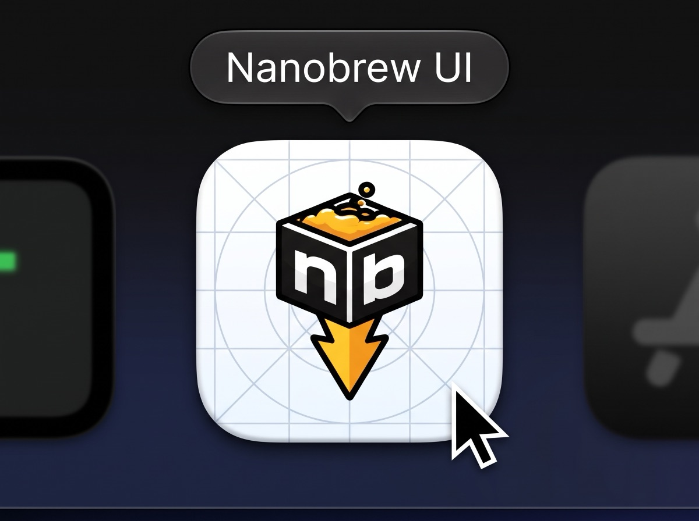

# Design language

Nanobrew UI uses one style, the framed sheet, in a light and a dark version. The app follows the Mac's light or
dark setting. All colours live in one place: `Theme` in `Sources/NanobrewUI/Theme.swift`. The approved mockups
are in [docs/UI/prototype_UI.html](UI/prototype_UI.html) (open the file in a browser). Where this page and the
mockups differ, this page describes what ships.

## The framed sheet

- **The frame.** The sidebar and the top bar are one opaque, tinted frame. No line separates them. There is no
  translucent sidebar material.
- **The sheet.** The content sits on a sheet: 8 px in from the window's right and bottom edges, 16 px corners,
  a 1 px edge in the `border` colour, and no shadow.
- **The window.** Default size 1280 × 800, with a hidden title bar. The sidebar is 228 px wide. The top bar is
  48 px high: the search field (400 × 32) in the middle, and the Check again button (32 × 32) at the right.

Reason: Nanobrew UI is a developer tool for short visits, with lists and a detail pane. The tinted frame and the
white sheet map onto the Mac window's sidebar, toolbar and content. The frame tint stays cool: a warm tint next
to the amber would read as a cream-and-terracotta theme, which the style avoids.

## Colour tokens

The light and dark values come from the approved mockups. The table shows the values that ship.

| Token | Light | Dark | Role |
|---|---|---|---|
| `frame` | `#f9fbfc` | `#000000` | The sidebar and the top bar |
| `sheet` | `#ffffff` | `#111111` | The content sheet, the console, dialogs, and the inside of fields and outlined buttons |
| `raised` | `#f4f6f8` | `#1a1a1a` | Code blocks: the install command, the dependency tree, the shell completions |
| `active` | `#ebedee` | `#262626` | The selected sidebar row and table row, the console toggle when open, "Keep open" when on, a disabled primary button |
| `border` | `#e8eaec` | `#2e2e2e` | The sheet edge, dialog edges, the tab rule, the console edge, the logo tile edge |
| `rule` | `#f0f1f2` | `#1e1e1e` | The line under each table row and each settings row |
| `control` | `#cdced1` | `#444444` | The edge of fields, outlined buttons and the Check again button |
| `text` | `#131416` | `#ffffff` | Main text |
| `muted` | `#5d5f60` | `#b4b4b4` | Secondary text, table headers, flags, icons at rest |
| `amber` | `#ba8122` | `#f8ac2d` | Amber marks: the selected tab's underline, the running dot, the icon in the Reinstall dialog |
| `amberText` | `#8b6019` | `#f8ac2d` | Amber text: new versions, the Updates count, "updates waiting", the "Can't upgrade in place" badge, the restart bar |
| `amberBg` | `#fbf4e6` | `#2a2112` | Behind the Updates count, the badge and the restart bar |
| `positive` | `#1e7b4f` | `#3fc07a` | The success dot; the text of a "Running" service pill |
| `positiveBg` | `#e6f4ec` | `#12261b` | Behind a "Running" service pill |
| `negative` | `#c4242a` | `#e5566f` | The failure dot, error text, "Remove…", and the outlined buttons of a destructive choice |
| `primary` | `#131416` | `#ffffff` | The primary button; the tint of switches and checkboxes |
| `onPrimary` | `#ffffff` | `#000000` | Text on the primary button |
| `pillBg` | `#ebedee` | `#262626` | Behind a neutral pill |
| `pillInk` | `#353736` | `#d4d4d4` | Text of a neutral pill |
| `scrim` | `#131416` at 28 % | `#000000` at 50 % | Behind the Reinstall dialog |

Two mockup tokens do not ship: `page` (the canvas around the mockup window) and `edge` (the mockup window's edge).
macOS draws the real window. The app adds one token that the mockups do not have: `positiveBg`, for the service
pill.

## What colour means

- **Amber means "needs your attention", and nothing else.** It marks a new version, the Updates count, the
  selected tab, a running command, the "Can't upgrade in place" badge and the restart bar. Buttons are never amber.
- **Red means failure or loss.** It marks a failed command, an error text, and the buttons that remove things.
- **Green means success.** It marks a command that ended well, and a service that runs.
- **Grey means neutral.** A cancelled or skipped command gets a grey dot. Pills such as "Pinned" are grey.
- **The primary colour is near-black** (white in dark mode).
- **The colour budget:** colour covers less than 3 % of the screen.

Light mode has two ambers. Marks use `#ba8122` (3.36:1 on white, enough for a non-text mark). Text uses the
darker `#8b6019` (5.55:1 on white, 4.72:1 on the selected-row grey). An earlier text shade, `#95671b`, failed
4.5:1 on the selected row. Dark mode uses the logo's own amber, `#f8ac2d`, for both (9.83:1 on `#111111`).

## Type

- **SF Pro**, the system font, for all text. A native Mac app uses the system font. (The style's sheet named IBM
  Plex Sans; the app replaces it on purpose.)
- **Tabular figures** (`.monospacedDigit()`) wherever numbers line up or change: versions, counts, dates,
  durations, the status line and the sublines.
- **SF Mono** only for nb's own text and for flags: the console, the dependency tree, the shell completions, the
  install command, and the grey flags after plain words.

| Size | Weight | Use |
|---|---|---|
| 22 | semibold | The screen title (h1); the app name in About |
| 18 | semibold | The package name in the detail pane |
| 16 | semibold | The Reinstall dialog title; "Danger zone" |
| 14 | regular, medium, semibold | Sidebar rows, table rows, sublines, tabs, settings row titles (medium), detail section heads (semibold) |
| 13 | regular, medium | Buttons (medium), descriptions, detail fields, text fields, dialog text, the console header (semibold) |
| 12 | regular, medium | Sidebar group headers, table headers, pills (medium), the status line, the Updates count (semibold), flags (SF Mono), console output (SF Mono) |
| 11 | regular | The shell completions script (SF Mono) |

## The sidebar

- At the top: the nanobrew logo on a white 28 px tile with 7 px corners, "Nanobrew UI" (14 semibold), and a grey
  scope line with the installed nb version, for example "nb 0.1.214 · /opt/nanobrew" (or "nb not found").
- Two groups: Packages (Installed, Updates, Discover) and System (Services, Maintenance, Bundle). Settings sits
  at the bottom.
- Each row is 32 px high, with a 16 px Lucide icon and the name at 14. Icons are grey; the selected row's icon
  takes the text colour.
- The selected row is a neutral grey pill (`active`, 8 px corners). It is never amber.
- Only Updates has a count, and only when updates exist: amber text on `amberBg` in a capsule, 12 semibold, with
  tabular figures.

## Screen anatomy

Each screen has 24 px padding and the same parts, top to bottom:

1. **One h1**, 22 px semibold. VoiceOver reads it as a header.
2. **A grey subline**, 14 px, that states the finding about the user's data:

   | Screen | Subline |
   |---|---|
   | Installed | `<n> formulae · <n> casks · <n> updates waiting` (the last part shows only when updates exist; it is an amber link to Updates) |
   | Updates | `4 updates: 2 ready, 1 pinned, 1 needs a reinstall` (parts at 0 are left out) |
   | Discover | `<n> results for “<query>” · searched in <duration>` |
   | Services | `<n> services, <n> running` |
   | Maintenance | `<n> packages in /opt/nanobrew · auto-update on` (or `off`) |
   | Bundle, Settings | One fixed sentence about the screen |

3. **The content**: a table, or settings rows.

### Tables

- A header row: 12 px grey, 36 px high.
- Rows: 44 px high (Installed, Services) or 52 px (Updates, Discover), with a 1 px `rule` line under each.
- The name column takes the free width. Numbers (version, install date, available version) are right-aligned,
  with tabular figures.
- The selected row gets the `active` grey with 6 px corners.
- **One status mark per row**, at most:

  | Screen | Marks |
  |---|---|
  | Installed | a "Pinned" pill, or amber "Update <version>" with the circle-arrow-up icon, or nothing |
  | Updates | grey "Ready", a "Pinned, skipped" pill, or the amber "Can't upgrade in place" badge |
  | Discover | an "Installed" pill, then the kind (formula or cask) in grey |
  | Services | a green "Running" pill or a grey "Stopped" pill |

- Installed has two tabs, Formulae and Casks, each with its count. The selected tab is semibold, with a 2 px amber
  underline.
- A detail pane sits at the right of Installed (400 px at start) and Discover (420 px). A 1 px edge with a 7 px
  drag area resizes it.
- An empty state is one plain grey sentence: "All packages are up to date.", "Select a package to see its
  details."

## Components

### The status line

The status line is 36 px high, at the bottom of the sheet, with a 1 px `border` line on top. It is 12 px grey
text with tabular figures:

- an 8 px dot: amber while a command runs, green after a success, red after a failure, grey after a cancel or a
  skip;
- the text, for example "Installed jq in 0.84 s" (selectable; long text is cut in the middle);
- "· <time of day>";
- at the right, the Console toggle with the terminal icon and "⌘J". It is grey, on `active` when the console is
  open.

Durations read "84 ms", "0.84 s", "12.3 s" and "1 m 05 s". The status line hides while the console shows.

### The console

- It opens by itself when a command starts, and closes when the last command ends, unless "Keep open" is on. ⌘J
  opens and closes it.
- It starts at 212 px high. A drag on its top edge sets 120 to 600 px, and never so much that the content gets
  less than 200 px.
- The 40 px header holds: the dot; "Running: <commands>" or the last result (13 semibold); the time since the
  start (it counts up) or the time of day; "<n> waiting" when commands wait; Cancel (outlined, 26 px); "Keep open"
  (a text toggle, on `active` when on); and a chevron that hides the console.
- The output is 12 px SF Mono on the sheet, 24 px from the edge. A drag selects across lines.

### Pills and badges

- **Neutral pill:** `pillInk` on `pillBg`, 12 medium, 20 px high (22 in Updates), 4 px corners. "Pinned",
  "Installed", "Pinned, skipped", "Stopped".
- **Running pill:** `positive` on `positiveBg`, the same shape.
- **"Can't upgrade in place" badge:** `amberText` on `amberBg`, 22 px high, with the triangle-alert icon. It adds
  nb's reason in plain words when it has them ("Can't upgrade in place: disk image"). The tooltip shows nb's own
  text.

### Buttons

| Kind | Look | Examples |
|---|---|---|
| Primary | `primary` with `onPrimary` text, 32 px, 6 px corners, 13 medium. Disabled: `active` with grey text. | "Upgrade <n>", "Install jq", "Upgrade to <version>", "Set up nanobrew", the Cancel of the Reinstall dialog |
| Outlined | `sheet` with a `control` edge, 28 px, 6 px corners | "Upgrade" in a row, "Export…", "Save", "Dry Run" |
| Outlined negative | `negative` text and edge | "Remove and Reinstall", "Migrate from Homebrew…", "Remove nanobrew (nuke)…" |
| Text | 13 px text, no box | "Pin", "Link", "Unlink", "Switch", "Probe", "Remove…" (in `negative`) |

A screen area has at most one primary button. Switches (small, tinted `primary`) sit in settings rows. Checkboxes
hold the install options.

### Confirmations

A command that removes or resets asks first, in the system alert: "Run <command>?", "This changes your system.",
and the buttons Run and Cancel. `nb nuke` also needs a typed "yes": the alert has a "Type yes" field, Run stays
disabled until the field holds exactly `yes`, and the text reads "This removes nanobrew and everything it
installed. Type yes to go on."

### The Reinstall dialog

The dialog covers the whole window, over the `scrim`.

- A 460 px card on the `sheet`, 12 px corners, a `border` edge, 132 px from the top. It is the only element with a
  shadow: a dialog may float.
- The title "Reinstall <name>?" (16 semibold), after an amber triangle-alert icon (20 px).
- The text says why nb can't upgrade the cask in place, that Reinstall removes the installed version first and
  then installs the new one, that the cask stays removed if the install fails (for example with no network), and
  that the settings in `~/Library` stay. A bold last line says "Quit <name> before you continue."
- Two buttons: "Remove and Reinstall" (outlined negative) and "Cancel" (primary). Cancel is the default: Return
  presses it. Escape and a click on the scrim cancel too.

### Settings rows

Maintenance, Bundle and Settings use the same row: a title (14 medium) and a grey description (13) on the left,
the controls on the right, 14 px above and below, and a `rule` line under it. The description says what the
control does in words, and names the nb command when that helps ("Writes the list of what nanobrew has installed
(nb bundle dump) to a file you choose.").

### The danger zone

The Settings screen ends with "Danger zone" (16 semibold). It has two rows: "Migrate from Homebrew" and "Remove
nanobrew". Their buttons are outlined in `negative`, end in "…", and the description states the consequence
("Deletes nanobrew and every package it installed, for good. You type yes to confirm."). While a changing command
runs or waits, both are disabled, with "Wait until no command runs." above them: a queued nuke could not be taken
back.

### Other parts

- **The restart bar:** after the app upgraded itself, an `amberBg` strip at the top of the sheet says "Restart to
  use the new version", with an outlined Restart button.
- **The search field:** in the top bar of Installed, Updates and Discover only. It has a 14 px search icon, a
  placeholder ("Search installed packages", "Search updates", "Search formulae and casks") and a "⌘F" hint.
- **Setup screens:** "nanobrew is not installed" shows the install command in a `raised` block as selectable
  text. "nanobrew is not set up" shows the "Set up nanobrew" primary button.

## Plain words first, the flag after

Every option says what it does in plain words, then shows nb's flag in grey SF Mono (12 px after 13 px text):

| Words | Flag |
|---|---|
| Keep dependency tools private | `--shims` |
| Only verified packages | `--trusted-only` |
| Newest verified build | `@trusted` |
| Remove phantom keg entries | `--prune-kegs` |
| Also upgrade packages | `--upgrade` |
| Show as a tree | `--tree` |
| It is a cask | `--cask` |

The trust line reads the same way: nb's `source-verified (local probe: not recorded; …)` becomes "Source verified ·
not probed yet". Button labels name the action: "Update nanobrew", "Update Registry", "Remove nanobrew (nuke)…".

## Icons

- Icons come from [Lucide](https://lucide.dev): lucide-static 1.66.0, ISC License. The 13 SVG files live in
  `Sources/NanobrewKit/Resources/Icons`, at stroke width 1.5.
- `NSImage` loads them, and `IconView` draws them as template images, so they take the colour of the text around
  them. Icons are grey at rest.
- Sizes: 16 px in the sidebar and the top bar; 14 px in the status line, the search field and badges; 12 px for
  the external-link mark; 20 px in the Reinstall dialog.
- The set: package, circle-arrow-up, search, server, wrench, archive, settings (the sidebar); rotate-cw (Check
  again); terminal (Console); chevron-down (hide the console); triangle-alert (badge and dialog); external-link
  (homepage). `pin` is in the set too, but no screen draws it in 1.0.0.
- README and About credit Lucide. The nanobrew logo (Copyright 2026 Rach Pradhan, Apache-2.0) appears on a white
  rounded tile: 28 px in the sidebar, 72 px in About.
- The app icon is the same logo on a white macOS rounded square, with no grid lines (`scripts/make-icon.swift`):

  

## Accessibility

**Contrast.** All text is at 4.5:1 or more on its own surface, in both themes:

| Pair | Light | Dark |
|---|---|---|
| `text` on `sheet` | 18.43 | 18.88 |
| `muted` on `sheet` | 6.42 | 9.11 |
| `muted` on `active` (selected row) | 5.47 | 7.30 |
| `muted` on `frame` (sidebar) | 6.18 | 10.13 |
| `amberText` on `sheet` | 5.55 | 9.83 |
| `amberText` on `active` | 4.72 | 7.88 |
| `amberText` on `amberBg` | 5.07 | 8.25 |
| `positive` on `positiveBg` | 4.63 | 6.85 |
| `negative` on `sheet` | 5.78 | 5.30 |
| `pillInk` on `pillBg` | 10.21 | 10.21 |
| `onPrimary` on `primary` | 18.43 | 21.00 |

The light `amber` mark (3.36:1 on white) carries no text.

**Keyboard.**

- ↑ and ↓ move the selection in the Installed and Discover lists, and scroll to it.
- ⌘R checks again, ⌘J opens and closes the console, ⌘F goes to the search field.
- Return in the search field searches again on Discover.
- In the Reinstall dialog, Return and Escape both cancel.

**Real controls.** Sidebar rows, tabs, table rows and search results are real buttons. The selected one carries
the selected trait. Icon-only buttons have labels ("Check again", "Show console", "Hide console"). The Updates count
reads "<n> updates". Icons and status dots are hidden from VoiceOver, because the text next to them says the same.
Status texts, errors and package details are selectable.

## What the style forbids

- Gradients.
- Glass: translucent or blurred materials.
- Shadows at rest. Only a dialog may float.
- Emoji.
- Tinted squares behind icons.
- Amber on buttons, and colour on more than 3 % of the screen.

## The mockups

[docs/UI/prototype_UI.html](UI/prototype_UI.html) holds the approved mockups: Installed with its detail pane,
Updates with a cask that needs a reinstall, the Reinstall dialog and Discover, each in light and dark. Services,
Maintenance, Bundle, Settings and About have no mockup. They use the same tokens, frame, tables and settings rows,
with destructive actions last.
